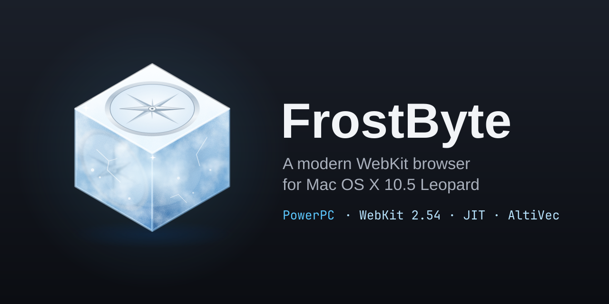
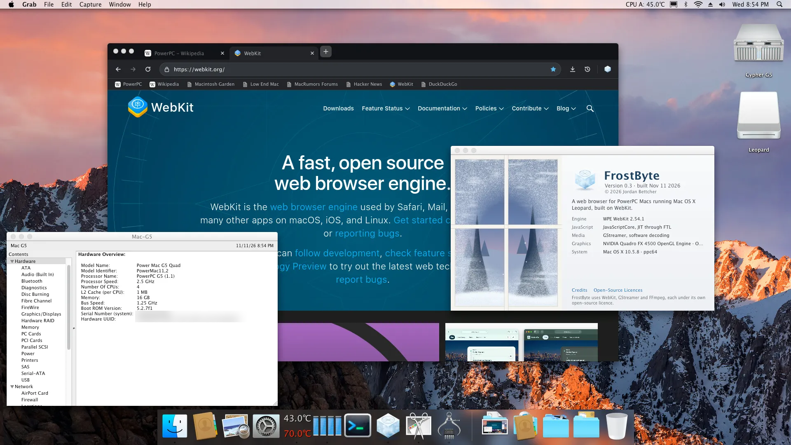
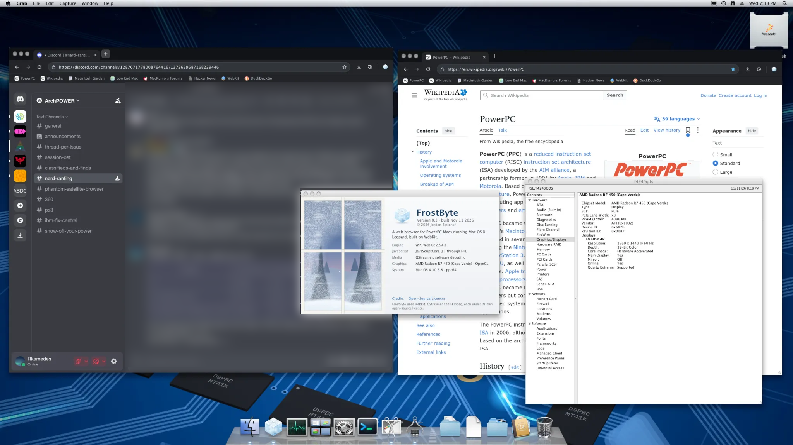

<p align="center"></p>

# FrostByte

FrostByte is a web browser for Mac OS X 10.5 Leopard on 64-bit PowerPC. It
puts a native Cocoa interface, modelled on Camino, on WPE WebKit 2.54.1, with
JavaScriptCore's JIT compilers ported to big-endian PowerPC. It loads current
sites over TLS 1.3 and HTTP/2, and plays media through GStreamer and FFmpeg.

FrostByte.app is self-contained: every library it uses is inside the bundle,
and nothing needs to be installed alongside it.

**Status: experimental.** Expect rough edges and missing features.


[](docs/screenshots/frostbyte-g5.png)

[](docs/screenshots/frostbyte-e6500.png)

## Download

Version 0.3.3, from the [v0.3.3 release](https://github.com/jbettcher-wg/frostbyte/releases/tag/v0.3.3):

| File | For |
|---|---|
| `FrostByte-0.3.3-G5.dmg` | Power Mac G5 (PowerPC 970, 970FX, 970MP) |
| `FrostByte-0.3.3-e6500.dmg` | NXP T4240 and other e6500 systems running Mac OS X 10.5 |

SHA-256 checksums are in `SHA256SUMS` on the release page. Open the disk image
and drag FrostByte to Applications.

**Branches.** `release-0.3` holds the 0.3.x releases and their fixes; `main` is
where development happens (WebGL for 0.4 is under way there) and may be less
stable. Build `release-0.3` for the released version.

## System requirements

FrostByte is a 64-bit (ppc64) program only.

| | Required | Recommended |
|---|---|---|
| System | Mac OS X 10.5.8 (Leopard) | |
| Processor | a 64-bit PowerPC: PowerPC G5 (970, 970FX, 970MP) or e6500 | a dual-core or dual-processor G5 |
| Graphics | any | a Quartz Extreme capable graphics card (accelerated compositing; without one, pages are drawn in software and scrolling is slower) |
| Disk | about 270 MB | |

It does not run on a G3 or G4 (32-bit PowerPC) or on Intel Macs.

## What is inside

| Area | Components |
|---|---|
| Engine | WPE WebKit 2.54.1 with the Leopard/PowerPC port, Skia (with AltiVec paths) |
| JavaScript | JavaScriptCore: LLInt interpreter, Baseline JIT, DFG and FTL optimising JITs, WebAssembly (in-place interpreter and BBQ JIT) |
| Graphics | LeopardEGL: EGL 1.5 and OpenGL ES 2 over Leopard's OpenGL |
| Media | GStreamer 1.28.9; FFmpeg 8.0.3 (H.264, VP8, VP9, AAC, MP3, Opus, Vorbis, FLAC decoders); dav1d 1.5.2; libogg 1.3.6, libvorbis 1.3.7; orc 0.4.42 |
| Networking | libsoup 3.6.5 with nghttp2 1.66.0 (HTTP/2), glib-networking 2.80.1, libpsl 0.21.5 |
| TLS | GnuTLS 3.8.10 (TLS 1.3), Nettle 3.10.2, GMP 6.3.0, libtasn1 4.20.0; Mozilla's CA certificates |
| Platform | GLib 2.84.4, ICU 77.1, libxml2 2.13.8, SQLite 3.50.4, libgcrypt 1.11.1, libiconv 1.18 |
| Text | HarfBuzz 11.2.1, FreeType 2.13.3, Fontconfig 2.16.0 |
| Images | libpng 1.6.50, libjpeg-turbo 3.1.1, libwebp 1.6.0 |
| Compiler | GCC 15.3.0 and cctools 877.8 / ld64 253.9 for `powerpc-apple-darwin9`, with patches |

The exact versions and checksums of every source are in
[`config/sources.lock`](config/sources.lock).

## Building

One command builds FrostByte.app from a fresh clone:

```sh
./build.sh --sdk=/path/to/xcode314_2809_developerdvd.dmg
```

It sets up the compiler, downloads and verifies the sources, builds the
libraries, WebKit and the browser, and leaves the app in
`build/dist/FrostByte-<target>/FrostByte.app`. Later runs redo only what changed.

**Build machines.** Linux (x86_64, arm64) and macOS (Intel, Apple Silicon)
cross-build; Mac OS X 10.5 on a 64-bit PowerPC builds natively. `./build.sh
check` lists any missing tools with the command that installs them. On
Debian/Ubuntu:

```sh
sudo apt install python3 perl libjson-pp-perl ruby cmake ninja-build pkg-config \
  build-essential rsync xz-utils bzip2 curl shared-mime-info libffi-dev \
  libpcre2-dev zlib1g-dev llvm p7zip-full cpio
```

On macOS: `xcode-select --install`, then `brew install python cmake ninja
pkg-config ruby rsync xz shared-mime-info libffi pcre2 llvm`.

**The Mac OS X 10.5 SDK.** Apple's licence does not allow redistributing it,
so you supply it from Xcode 3.1.4 (`xcode314_2809_developerdvd.dmg`, available
to free Apple Developer accounts at <https://developer.apple.com/download/all/>).
`--sdk=` takes the disk image, the `MacOSX10.5.pkg` inside it, or an installed
`MacOSX10.5.sdk`; the build checks it against Xcode 3.1.4's SDK.

**Targets.** `--target=generic` (the default: runs on the G5 and the e6500),
`--target=g5` (PowerPC 970) or `--target=t4240` (e6500).

**Time.** About an hour on a 16-core Linux machine with 64 GB of memory. The
compiler comes prebuilt for Linux x86_64 and is otherwise built from source
(10-60 minutes). Parallel jobs follow available memory, since WebKit needs
2-4 GB per compile job.

[docs/building.md](docs/building.md) has the details: the stages, what is
downloaded and where it is kept, the compiler and its prebuilt tarballs, and
native builds on a G5.

## Licence and credits

FrostByte's own code is under the MIT licence, Copyright (c) 2026 Jordan
Bettcher ([LICENSE](LICENSE)). The components above keep their own licences;
[NOTICE](NOTICE) lists each one, and FrostByte.app carries their licence texts.

FrostByte builds on the work of the WebKit and WPE WebKit projects, GStreamer,
FFmpeg, VideoLAN's dav1d, GNOME (GLib, libsoup), GnuTLS, the Unicode
Consortium's ICU, HarfBuzz, FreeType, Fontconfig, the GCC project, and Thomas
Pöchtrager's cctools-port. The toolbar and tab artwork comes from Camino
(Mozilla Public Licence 2.0).
